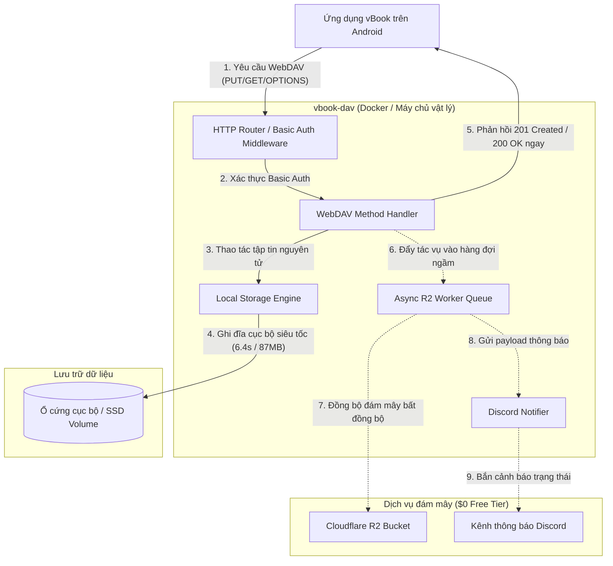
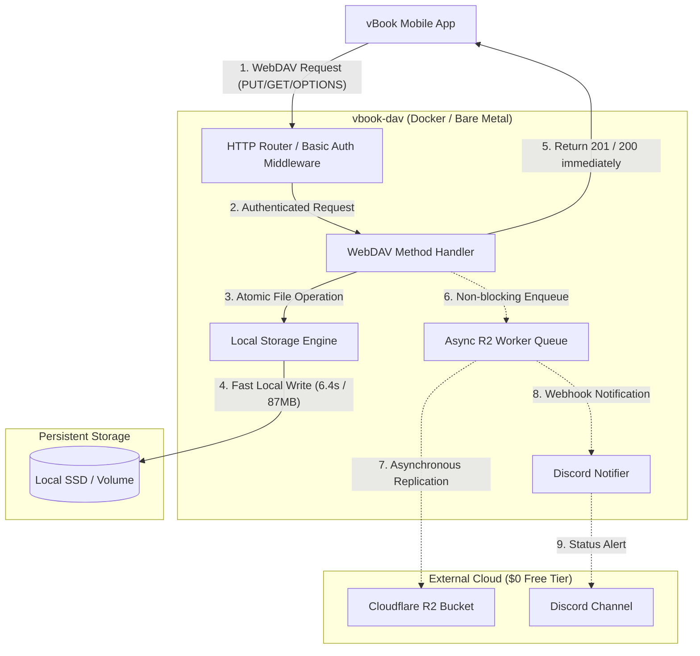

# Kiến Trúc Hệ Thống & Thiết Kế Kỹ Thuật / System Architecture & Technical Design

[Tiếng Việt](#-tiếng-việt) • [English](#-english)

---

<a id="-tiếng-việt"></a>
## 🇻🇳 Tiếng Việt

Tài liệu này mô tả chi tiết thiết kế kiến trúc, mô hình luồng dữ liệu, cơ chế ghi đĩa nguyên tử và tính năng sao lưu bất đồng bộ của `vbook-dav`.

### 1. Triết Lý Thiết Kế Cốt Lõi

`vbook-dav` là máy chủ WebDAV độc lập, siêu nhẹ, mã nguồn mở được thiết kế chuyên biệt cho ứng dụng đọc truyện **vBook** trên Android. Hệ thống tuân thủ 3 nguyên lý kiến trúc:

1. **Ghi trước cục bộ, đồng bộ ngầm (Local-first write-behind)**: Mọi thao tác ghi (`PUT`, `DELETE`) được thực thi trực tiếp xuống ổ đĩa cục bộ với tốc độ cao nhất (dưới 7 giây cho gói 87 MB), lập tức phản hồi `201 Created` cho thiết bị di động. Việc sao lưu lên đám mây (Cloudflare R2) được thực hiện ngầm trong nền, không làm gián đoạn trải nghiệm người dùng.
2. **Dao cạo Occam (Không sử dụng cơ sở dữ liệu)**: Quản lý người dùng đơn lẻ hoàn toàn thông qua biến môi trường với giải thuật so khớp thời gian hằng số (`ConstantTimeCompare`). Việc loại bỏ toàn bộ các hệ quản trị cơ sở dữ liệu (SQLite, PostgreSQL, Turso) giúp triệt tiêu hoàn toàn rủi ro khóa file (database lock), lỗi migration và gánh nặng bảo trì.
3. **Lõi không phụ thuộc (Zero-dependency core)**: Máy chủ WebDAV và hệ thống lưu trữ vận hành 100% bằng thư viện chuẩn của Go (`net/http`, `os`, `io`). Thư viện ngoài duy nhất được dùng là AWS SDK Go v2 phục vụ kết nối tới API S3 của Cloudflare R2.

---

### 2. Sơ Đồ Kiến Trúc Tổng Thể



---

### 3. Quy Trình Ghi Tập Tin Nguyên Tử (Atomic Write Pipeline)

Để đảm bảo không bao giờ xảy ra tình trạng bản sao lưu bị hỏng (corrupted) do mất điện hoặc rớt kết nối mạng trong quá trình upload, `vbook-dav` áp dụng quy trình 4 giai đoạn nghiêm ngặt:

```
[Luồng nhị phân tải lên]
          ↓
1. Staging: Ghi vào tệp tạm `<target-path>.<uuid>.tmp`
          ↓
2. Flushing: Gọi file.Sync() ép hệ điều hành ghi xuống đĩa vật lý
          ↓
3. Closing: Đóng handle file (Bắt buộc trên Windows để tránh ERROR_SHARING_VIOLATION)
          ↓
4. Renaming: Gọi os.Rename() thay thế tệp đích tức thời và nguyên tử
```

- **Tự động dọn dẹp khi khởi động**: Mỗi khi máy chủ khởi động, hàm `CleanupTempFiles()` tự động quét thư mục `DATA_DIR` và xóa sạch mọi tệp `.tmp` tồn đọng do các sự cố trước đó.

---

### 4. Cơ Chế Sao Lưu Đám Mây Bất Đồng Bộ (Cloudflare R2)

Khi người dùng cấu hình các biến `R2_*`:
- **Hàng đợi đệm (Buffered Queue)**: Các tác vụ upload/delete được đẩy vào một Go channel có đệm (`cap=64`). Thao tác đẩy này không phong tỏa (non-blocking) luồng WebDAV chính.
- **Worker chuyên trách**: Một goroutine độc lập tuần tự lấy từng tác vụ ra xử lý và truyền tải lên Cloudflare R2 thông qua API tương thích S3.
- **Đối soát khi khởi động (Startup Reconciliation)**: Khi máy chủ khởi động, một goroutine chạy ngầm sẽ quét toàn bộ thư mục dữ liệu cục bộ và đối soát với danh sách khóa trên bucket R2. Những tệp nào có ở cục bộ nhưng chưa có trên R2 sẽ được tự động xếp vào hàng đợi đồng bộ.
- **Dung sai lỗi**: Nếu hàng đợi bị đầy, tác vụ sẽ bị loại bỏ an toàn kèm log cảnh báo mà không làm gián đoạn việc ghi đĩa cục bộ của người dùng.

---

### 5. Mô Hình Bảo Mật Thư Mục Lưu Trữ

1. **Chống Path Traversal**: Chuẩn hóa toàn bộ đường dẫn thông qua `path.Clean` và kiểm tra `filepath.Rel` để đảm bảo không một yêu cầu HTTP nào có thể thoát ra khỏi thư mục `baseDir`.
2. **Chặn luồng dữ liệu phụ NTFS (ADS)**: Chặn mọi yêu cầu chứa ký tự dấu hai chấm `:`, ngăn chặn tấn công truy xuất tệp ẩn trên hệ thống tệp Windows NTFS.
3. **Chặn tên thiết bị cấm DOS trên Windows**: Kiểm tra và chặn các tên tệp đặc thù (`CON`, `PRN`, `AUX`, `NUL`, `COM1-9`, `LPT1-9`).
4. **Bảo vệ thư mục gốc (Root Collection Protection)**: Các thao tác nguy hiểm như `DELETE /`, `PUT /`, `MOVE /` nhắm vào thư mục gốc đều bị từ chối với mã lỗi `403 Forbidden` hoặc `405 Method Not Allowed`, bảo toàn dữ liệu máy chủ.

---

<a id="-english"></a>
## 🇬🇧 English

This document provides a comprehensive technical overview of the architecture, data flow pipelines, atomic disk writes, and asynchronous replication mechanisms in `vbook-dav`.

### 1. Core Architectural Philosophy

`vbook-dav` is an open-source, lightweight, self-hosted WebDAV server optimized specifically for the Android novel reader application **vBook**. The architecture adheres to three core design principles:

1. **Local-first write-behind**: Client write mutations (`PUT`, `DELETE`) commit immediately to the local storage subsystem, returning `201 Created` in milliseconds. Asynchronous replication to secondary cloud storage (Cloudflare R2) runs non-blockingly in the background.
2. **Occam's razor (No database)**: Single-user authentication is handled via environment variables with constant-time comparison (`ConstantTimeCompare`). Eliminating databases (SQLite, PostgreSQL, Turso) removes database locking issues, migration errors, and ongoing operational maintenance.
3. **Resilient zero-dependency core**: The core WebDAV server and storage engine rely solely on the Go standard library (`net/http`, `os`, `io`). The only external dependency is the official AWS SDK Go v2 for S3-compatible cloud replication.

---

### 2. High-Level Architecture Diagram



---

### 3. Atomic Write Pipeline

To ensure backup archives are never corrupted by unexpected power loss or dropped connections during transfer, `vbook-dav` implements a strict four-stage atomic write pipeline:

```
[Incoming Payload Stream]
          ↓
1. Staging: Stream to temporary file `<target-path>.<uuid>.tmp`
          ↓
2. Flushing: Invoke file.Sync() to commit OS page cache to physical disk
          ↓
3. Closing: Close file handle (Mandatory on Windows to avoid ERROR_SHARING_VIOLATION)
          ↓
4. Renaming: Atomically replace target destination via os.Rename()
```

- **Startup Cleanup**: On server initialization, `CleanupTempFiles()` traverses `DATA_DIR` and purges orphaned `.tmp` files from interrupted sessions.

---

### 4. Asynchronous Cloud Replication (Cloudflare R2)

When configured with `R2_*` variables:
- **Buffered Worker Queue**: Upload and deletion jobs enter a buffered Go channel (`cap=64`). Enqueuing is non-blocking to preserve WebDAV request throughput.
- **Dedicated Worker Goroutine**: A background worker sequentially processes queue items and replicates them to Cloudflare R2 using standard S3 API calls.
- **Startup Reconciliation**: A startup routine scans local storage and reconciles against remote R2 bucket keys, automatically scheduling any missing files for upload.
- **Graceful Fallback**: If the queue fills under heavy load, excess jobs are dropped safely with warning logs, without disrupting client writes.

---

### 5. Storage Boundary and Security Model

1. **Path Traversal Defense**: All virtual paths are cleaned via `path.Clean` and checked against the storage root using `filepath.Rel` to ensure requests cannot escape `baseDir`.
2. **NTFS Alternate Data Stream (ADS) Blocking**: Any path segment containing a colon `:` is rejected, preventing access to hidden metadata streams on Windows NTFS.
3. **Windows Reserved Name Filtering**: DOS device identifiers (`CON`, `PRN`, `AUX`, `NUL`, `COM1-9`, `LPT1-9`) are rejected.
4. **Root Collection Protection**: Destructive operations (`DELETE /`, `PUT /`, `MOVE /`) against the root storage directory return `403 Forbidden` or `405 Method Not Allowed`, preventing catastrophic data loss.
